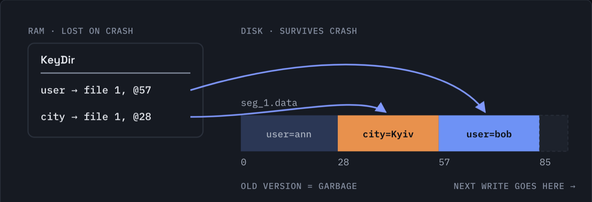
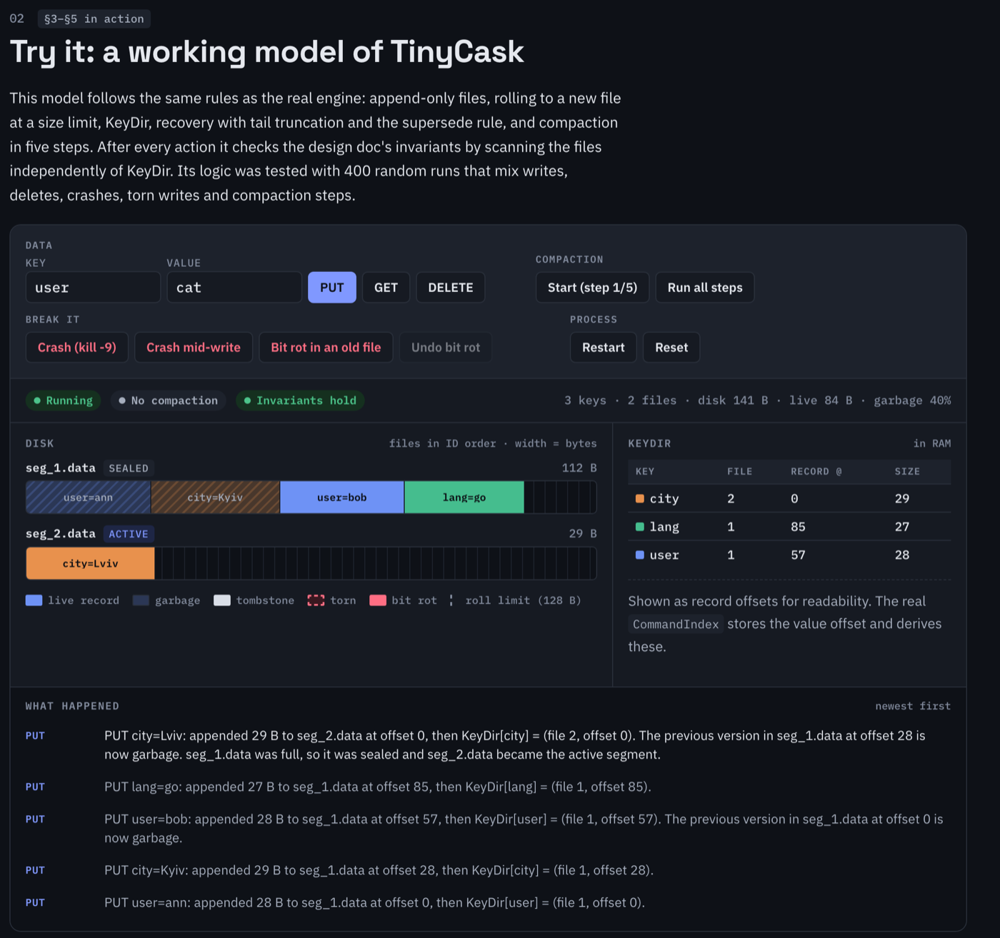

# TinyCask

A small key-value database in Go, built the way [Bitcask](https://riak.com/assets/bitcask-intro.pdf) is: every write is appended to a log file on disk, and a hash map in memory remembers where the newest value of each key lives. It speaks a subset of the Redis protocol, so `redis-cli` works as a client.

> **Status:** design complete, implementation in progress. The commands below describe the target behaviour.

## How it works, interactively

**[Open the interactive explainer →](https://maks9m.github.io/TinyCask/guide/)**

The explainer walks through the whole design: the record format byte by byte, crash recovery, compaction, locking, fsync and durability, the network protocol and the testing strategy. It includes a working model of the database you can write to, crash, compact and corrupt in your browser.



[](https://maks9m.github.io/TinyCask/guide/#sim)

## The design in one minute

- **Append-only log.** PUT and DELETE append a record (21-byte header with a CRC32 checksum, then the key and value) to the active segment file. Nothing on disk is ever changed in place.
- **KeyDir.** An in-memory hash map from each key to the file and offset of its newest record. A GET is one map lookup and one disk read.
- **Segments.** The log is split into files of up to 64 MiB. A full file is sealed and never written again.
- **Compaction.** A background job copies only the live records into a new file and deletes the old ones, so overwritten and deleted data stops taking disk space.
- **Crash recovery.** On startup the files are replayed in order to rebuild KeyDir. A record torn by a crash at the end of the newest file is cut off; damage anywhere else stops the database from opening rather than silently losing data.

The trade-off: every key must fit in RAM, and there are no range queries.

## Usage (target)

```bash
make build
./bin/tinycask -dir ./data          # listens on port 6380
```

```bash
redis-cli -p 6380 SET user ann      # OK
redis-cli -p 6380 GET user          # "ann"
redis-cli -p 6380 DEL user          # (integer) 1
```

Supported commands: `PING`, `SET`/`PUT`, `GET`, `DEL`/`DELETE`, `COMPACT`, `INFO`, `QUIT`.

## Documentation

| Document | What it covers |
| --- | --- |
| [Interactive explainer](https://maks9m.github.io/TinyCask/guide/) | The concepts, with diagrams and a simulator |
| [ARCHITECTURE.md](ARCHITECTURE.md) | Packages, on-disk format, flows, locks, durability, wire protocol |
| [docs/design-doc.md](docs/design-doc.md) | Requirements (in Ukrainian) |

## Credits

The design follows J. Sheehy and D. Smith, *Bitcask: A Log-Structured Hash Table for Fast Key/Value Data*, Basho Technologies, 2010.
